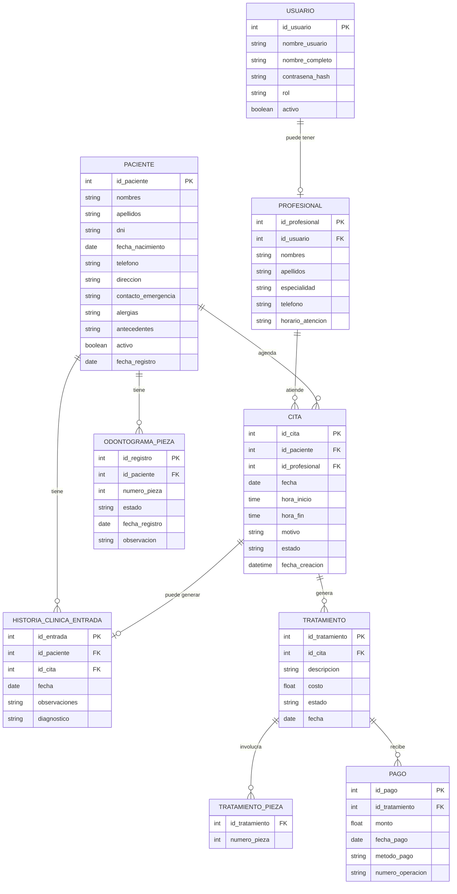

# Vyra — Modelo de Base de Datos

**Versión:** 0.2
**Fecha:** 2026-10-29
**Motor:** SQLite (según RNF-02 de los requerimientos)

> **Cambios respecto a la v0.1:** se agregan `usuario.nombre_completo`, `paciente.antecedentes`, `paciente.activo`, `pago.numero_operacion`, un `CHECK` para `pago.metodo_pago`, índices para las consultas frecuentes, la activación de claves foráneas y la sección 5 con las consultas clave. El script de la sección 3 es la versión que debe quedar en `src/main/resources/com/vyra/schema.sql`.

---

## 1. Diagrama entidad-relación



**Notas de diseño:**
- `HISTORIA_CLINICA_ENTRADA` y `ODONTOGRAMA_PIEZA` son tablas de historial: cada fila es un registro con fecha y nunca se sobrescribe (RN-09). Así CU-04 y CU-05 pueden mostrar la evolución del paciente.
- El **estado actual** de una pieza es el registro más reciente de esa pieza para ese paciente. Una pieza sin registros se considera `SANA` (ver la consulta 5.1).
- `TRATAMIENTO_PIEZA` es una tabla intermedia porque un tratamiento puede involucrar varias piezas dentales (muchos a muchos).
- `PROFESIONAL.id_usuario` es opcional: puede haber profesionales sin cuenta propia, aunque no es lo recomendado.
- El **saldo** de un tratamiento no se guarda; se calcula como `costo − SUM(pago.monto)` (consulta 5.3). Así nunca queda desactualizado.
- **Pacientes con baja lógica:** `activo = 0` los oculta de las búsquedas, pero sus citas, tratamientos y pagos siguen existiendo (RN-04).

## 2. Diccionario de datos

Convenciones de SQLite para todo el proyecto:
- **Fechas:** `TEXT` en formato ISO 8601 (`2026-10-29`). En Java se convierten con `LocalDate.parse()` y `fecha.toString()`.
- **Horas:** `TEXT` con formato `HH:MM` (`09:30`). En Java: `LocalTime.parse()` y `hora.toString()`.
- **Booleanos:** `INTEGER` con `1` o `0`.
- **Enums:** `TEXT` con el nombre exacto de la constante Java (`PENDIENTE`, `EN_CURSO`...). En Java: `EstadoCita.valueOf(texto)` y `estado.name()`.
- **Dinero:** `REAL`, siempre en soles (S/).

### USUARIO
| Campo | Tipo | Restricciones | Descripción |
|---|---|---|---|
| id_usuario | INTEGER | PK, autoincrement | Identificador único |
| nombre_usuario | TEXT | UNIQUE, NOT NULL | Usuario para iniciar sesión (3–30 caracteres) |
| nombre_completo | TEXT | NOT NULL | Se muestra en el menú lateral ("Daniel") |
| contrasena_hash | TEXT | NOT NULL | Hash PBKDF2 con sal, formato `pbkdf2$iteraciones$sal$hash` (RNF-05, RN-13) |
| rol | TEXT | NOT NULL | `ADMIN`, `RECEPCION` u `ODONTOLOGO` |
| activo | INTEGER | NOT NULL, default 1 | 1 = habilitado, 0 = deshabilitado (RN-14) |

### PROFESIONAL
| Campo | Tipo | Restricciones | Descripción |
|---|---|---|---|
| id_profesional | INTEGER | PK, autoincrement | Identificador único |
| id_usuario | INTEGER | FK → USUARIO, NULL permitido | Cuenta de acceso asociada |
| nombres, apellidos | TEXT | NOT NULL | Datos personales |
| especialidad | TEXT | | Ej. Ortodoncia, Endodoncia |
| telefono | TEXT | | 9 dígitos |
| horario_atencion | TEXT | | Ej. "Lun-Vie 08:00-14:00" (texto informativo) |

### PACIENTE
| Campo | Tipo | Restricciones | Descripción |
|---|---|---|---|
| id_paciente | INTEGER | PK, autoincrement | Identificador único |
| nombres, apellidos | TEXT | NOT NULL | |
| dni | TEXT | UNIQUE, NOT NULL | 8 dígitos, evita duplicados (CU-01, RN-01) |
| fecha_nacimiento | TEXT (ISO 8601) | | |
| telefono | TEXT | | 9 dígitos |
| direccion | TEXT | | |
| contacto_emergencia | TEXT | | Nombre y teléfono |
| alergias | TEXT | | Texto libre. Vacío = ninguna. Si tiene contenido, la UI muestra una alerta naranja |
| antecedentes | TEXT | | Antecedentes médicos generales (RF-04) |
| activo | INTEGER | NOT NULL, default 1 | Baja lógica (RN-04) |
| fecha_registro | TEXT (ISO 8601) | default hoy | "Paciente desde..." |

### CITA
| Campo | Tipo | Restricciones | Descripción |
|---|---|---|---|
| id_cita | INTEGER | PK, autoincrement | |
| id_paciente | INTEGER | FK → PACIENTE, NOT NULL | |
| id_profesional | INTEGER | FK → PROFESIONAL, NOT NULL | |
| fecha | TEXT (ISO 8601) | NOT NULL | |
| hora_inicio, hora_fin | TEXT (HH:MM) | NOT NULL | Bloques de 30 min (RN-05). Se usan para validar cruces (CU-03) |
| motivo | TEXT | | |
| estado | TEXT | NOT NULL, default 'PENDIENTE' | `PENDIENTE`, `CONFIRMADA`, `ATENDIDA`, `CANCELADA` |
| fecha_creacion | TEXT | default ahora | |

### HISTORIA_CLINICA_ENTRADA
| Campo | Tipo | Restricciones | Descripción |
|---|---|---|---|
| id_entrada | INTEGER | PK, autoincrement | |
| id_paciente | INTEGER | FK → PACIENTE, NOT NULL | |
| id_cita | INTEGER | FK → CITA, NULL permitido | Cita en la que se registró |
| fecha | TEXT | NOT NULL | |
| observaciones | TEXT | | |
| diagnostico | TEXT | | |

### ODONTOGRAMA_PIEZA
| Campo | Tipo | Restricciones | Descripción |
|---|---|---|---|
| id_registro | INTEGER | PK, autoincrement | |
| id_paciente | INTEGER | FK → PACIENTE, NOT NULL | |
| numero_pieza | INTEGER | NOT NULL, CHECK FDI | Notación FDI 11–18, 21–28, 31–38, 41–48 (RN-10) |
| estado | TEXT | NOT NULL | `SANA`, `CARIADA`, `OBTURADA`, `EXTRAIDA`, `EN_TRATAMIENTO` |
| fecha_registro | TEXT | NOT NULL | |
| observacion | TEXT | | Nota del cambio ("Caries oclusal profunda") |

### TRATAMIENTO
| Campo | Tipo | Restricciones | Descripción |
|---|---|---|---|
| id_tratamiento | INTEGER | PK, autoincrement | |
| id_cita | INTEGER | FK → CITA, NOT NULL | El paciente se obtiene a través de la cita |
| descripcion | TEXT | NOT NULL | |
| costo | REAL | NOT NULL, > 0 | |
| estado | TEXT | NOT NULL, default 'EN_CURSO' | `EN_CURSO`, `FINALIZADO` |
| fecha | TEXT | NOT NULL | |

### TRATAMIENTO_PIEZA
| Campo | Tipo | Restricciones | Descripción |
|---|---|---|---|
| id_tratamiento | INTEGER | FK → TRATAMIENTO | Clave compuesta |
| numero_pieza | INTEGER | | Clave compuesta |

### PAGO
| Campo | Tipo | Restricciones | Descripción |
|---|---|---|---|
| id_pago | INTEGER | PK, autoincrement | |
| id_tratamiento | INTEGER | FK → TRATAMIENTO, NOT NULL | |
| monto | REAL | NOT NULL, > 0 | No puede superar el saldo (RN-12) |
| fecha_pago | TEXT | NOT NULL | No futura |
| metodo_pago | TEXT | NOT NULL | `EFECTIVO`, `YAPE_PLIN`, `TARJETA`, `TRANSFERENCIA` (enum `MetodoPago`) |
| numero_operacion | TEXT | | Opcional, para Yape/Plin, tarjeta o transferencia |

## 3. Script SQL (SQLite)

Este es el contenido que debe tener `src/main/resources/com/vyra/schema.sql`. `ConexionBD` lo ejecuta en cada arranque; como usa `IF NOT EXISTS`, no borra datos.

> **Importante (desarrollo):** `CREATE TABLE IF NOT EXISTS` no agrega columnas nuevas a una tabla que ya existe. Si cambias el esquema, borra el archivo `vyra.db` local (está en `.gitignore`) para que se cree de nuevo. Cuando haya datos reales, los cambios se harán con `ALTER TABLE`.

> **Importante (claves foráneas):** SQLite no las verifica por defecto. `ConexionBD` debe ejecutar `PRAGMA foreign_keys = ON;` justo después de abrir la conexión.

```sql
CREATE TABLE IF NOT EXISTS usuario (
    id_usuario INTEGER PRIMARY KEY AUTOINCREMENT,
    nombre_usuario TEXT NOT NULL UNIQUE,
    nombre_completo TEXT NOT NULL,
    contrasena_hash TEXT NOT NULL,
    rol TEXT NOT NULL CHECK (rol IN ('ADMIN','RECEPCION','ODONTOLOGO')),
    activo INTEGER NOT NULL DEFAULT 1
);

CREATE TABLE IF NOT EXISTS profesional (
    id_profesional INTEGER PRIMARY KEY AUTOINCREMENT,
    id_usuario INTEGER REFERENCES usuario(id_usuario),
    nombres TEXT NOT NULL,
    apellidos TEXT NOT NULL,
    especialidad TEXT,
    telefono TEXT,
    horario_atencion TEXT
);

CREATE TABLE IF NOT EXISTS paciente (
    id_paciente INTEGER PRIMARY KEY AUTOINCREMENT,
    nombres TEXT NOT NULL,
    apellidos TEXT NOT NULL,
    dni TEXT NOT NULL UNIQUE,
    fecha_nacimiento TEXT,
    telefono TEXT,
    direccion TEXT,
    contacto_emergencia TEXT,
    alergias TEXT,
    antecedentes TEXT,
    activo INTEGER NOT NULL DEFAULT 1,
    fecha_registro TEXT DEFAULT (date('now'))
);

CREATE TABLE IF NOT EXISTS cita (
    id_cita INTEGER PRIMARY KEY AUTOINCREMENT,
    id_paciente INTEGER NOT NULL REFERENCES paciente(id_paciente),
    id_profesional INTEGER NOT NULL REFERENCES profesional(id_profesional),
    fecha TEXT NOT NULL,
    hora_inicio TEXT NOT NULL,
    hora_fin TEXT NOT NULL,
    motivo TEXT,
    estado TEXT NOT NULL DEFAULT 'PENDIENTE'
        CHECK (estado IN ('PENDIENTE','CONFIRMADA','ATENDIDA','CANCELADA')),
    fecha_creacion TEXT DEFAULT (datetime('now'))
);

CREATE TABLE IF NOT EXISTS historia_clinica_entrada (
    id_entrada INTEGER PRIMARY KEY AUTOINCREMENT,
    id_paciente INTEGER NOT NULL REFERENCES paciente(id_paciente),
    id_cita INTEGER REFERENCES cita(id_cita),
    fecha TEXT NOT NULL,
    observaciones TEXT,
    diagnostico TEXT
);

CREATE TABLE IF NOT EXISTS odontograma_pieza (
    id_registro INTEGER PRIMARY KEY AUTOINCREMENT,
    id_paciente INTEGER NOT NULL REFERENCES paciente(id_paciente),
    numero_pieza INTEGER NOT NULL
        CHECK (numero_pieza / 10 BETWEEN 1 AND 4 AND numero_pieza % 10 BETWEEN 1 AND 8),
    estado TEXT NOT NULL
        CHECK (estado IN ('SANA','CARIADA','OBTURADA','EXTRAIDA','EN_TRATAMIENTO')),
    fecha_registro TEXT NOT NULL,
    observacion TEXT
);

CREATE TABLE IF NOT EXISTS tratamiento (
    id_tratamiento INTEGER PRIMARY KEY AUTOINCREMENT,
    id_cita INTEGER NOT NULL REFERENCES cita(id_cita),
    descripcion TEXT NOT NULL,
    costo REAL NOT NULL CHECK (costo > 0),
    estado TEXT NOT NULL DEFAULT 'EN_CURSO' CHECK (estado IN ('EN_CURSO','FINALIZADO')),
    fecha TEXT NOT NULL
);

CREATE TABLE IF NOT EXISTS tratamiento_pieza (
    id_tratamiento INTEGER NOT NULL REFERENCES tratamiento(id_tratamiento),
    numero_pieza INTEGER NOT NULL,
    PRIMARY KEY (id_tratamiento, numero_pieza)
);

CREATE TABLE IF NOT EXISTS pago (
    id_pago INTEGER PRIMARY KEY AUTOINCREMENT,
    id_tratamiento INTEGER NOT NULL REFERENCES tratamiento(id_tratamiento),
    monto REAL NOT NULL CHECK (monto > 0),
    fecha_pago TEXT NOT NULL,
    metodo_pago TEXT NOT NULL
        CHECK (metodo_pago IN ('EFECTIVO','YAPE_PLIN','TARJETA','TRANSFERENCIA')),
    numero_operacion TEXT
);

CREATE INDEX IF NOT EXISTS idx_cita_profesional_fecha ON cita(id_profesional, fecha);
CREATE INDEX IF NOT EXISTS idx_cita_fecha ON cita(fecha);
CREATE INDEX IF NOT EXISTS idx_cita_paciente ON cita(id_paciente);
CREATE INDEX IF NOT EXISTS idx_historia_paciente ON historia_clinica_entrada(id_paciente);
CREATE INDEX IF NOT EXISTS idx_odontograma_paciente_pieza ON odontograma_pieza(id_paciente, numero_pieza);
CREATE INDEX IF NOT EXISTS idx_tratamiento_cita ON tratamiento(id_cita);
CREATE INDEX IF NOT EXISTS idx_pago_tratamiento ON pago(id_tratamiento);
CREATE INDEX IF NOT EXISTS idx_pago_fecha ON pago(fecha_pago);
```

> `ConexionBD` separa el script por `;`. Por eso el script no debe tener `;` dentro de comentarios ni de textos.

## 4. Datos iniciales

- **Usuario administrador:** no va en `schema.sql` porque la contraseña necesita calcularse con `HashUtil`. La clase `util.DatosIniciales` lo crea al arrancar (`crearAdminSiNoExiste(UsuarioDAO)`) **solo si la tabla `usuario` está vacía**: usuario `admin`, nombre "Administrador", rol `ADMIN`, contraseña inicial `admin123`. Se debe cambiar después del primer ingreso.
- **Datos de ejemplo (solo desarrollo):** `DatosIniciales.cargarEjemplos()` puede insertar los pacientes, profesionales y citas que aparecen en el diseño ([`docs/ui`](./ui)), para probar las pantallas con datos realistas. Se activa con la propiedad `-Dvyra.demo=true` y nunca en producción.

## 5. Consultas clave

Son las consultas que usan los DAO para las funciones más importantes. Todas usan `PreparedStatement` con `?`; nunca se concatenan valores en el SQL.

### 5.1 Estado actual del odontograma de un paciente (CU-05)
```sql
SELECT o.numero_pieza, o.estado, o.fecha_registro
FROM odontograma_pieza o
WHERE o.id_paciente = ?
  AND o.id_registro = (
      SELECT MAX(o2.id_registro) FROM odontograma_pieza o2
      WHERE o2.id_paciente = o.id_paciente AND o2.numero_pieza = o.numero_pieza
  );
```
Las piezas que no aparecen en el resultado son `SANA`.

### 5.2 Cruce de horario (CU-03, RN-06)
Dos rangos se traslapan si `inicioA < finB` y `inicioB < finA`. Como las horas se guardan en `HH:MM`, la comparación de textos funciona.
```sql
SELECT COUNT(*) FROM cita
WHERE id_profesional = ? AND fecha = ?
  AND estado IN ('PENDIENTE','CONFIRMADA')
  AND hora_inicio < ?      -- hora_fin de la cita nueva
  AND ? < hora_fin         -- hora_inicio de la cita nueva
  AND id_cita <> ?;        -- al reprogramar, excluir la propia cita (0 si es nueva)
```

### 5.3 Saldo de un tratamiento (CU-10, RN-12)
```sql
SELECT t.costo - IFNULL(SUM(p.monto), 0) AS saldo
FROM tratamiento t LEFT JOIN pago p ON p.id_tratamiento = t.id_tratamiento
WHERE t.id_tratamiento = ?
GROUP BY t.id_tratamiento;
```

### 5.4 Citas de un día, con paciente y profesional (agenda e inicio)
```sql
SELECT c.*, pa.nombres AS pa_nombres, pa.apellidos AS pa_apellidos, pa.dni,
       pr.nombres AS pr_nombres, pr.apellidos AS pr_apellidos, pr.especialidad
FROM cita c
JOIN paciente pa ON pa.id_paciente = c.id_paciente
JOIN profesional pr ON pr.id_profesional = c.id_profesional
WHERE c.fecha = ?
ORDER BY c.hora_inicio;
```

### 5.5 Ingresos por periodo (CU-09)
```sql
SELECT metodo_pago, COUNT(*) AS cantidad, SUM(monto) AS total
FROM pago
WHERE fecha_pago BETWEEN ? AND ?
GROUP BY metodo_pago;
```

### 5.6 Búsqueda de pacientes (pantalla Pacientes)
```sql
SELECT * FROM paciente
WHERE activo = 1
  AND (dni LIKE ? ESCAPE '\' OR (nombres || ' ' || apellidos) LIKE ? ESCAPE '\')
  -- filtro opcional (chips de la pantalla), un fragmento fijo según FiltroPaciente:
  --   CON_ALERGIAS:    AND alergias IS NOT NULL AND TRIM(alergias) <> ''
  --   MENORES_DE_EDAD: AND fecha_nacimiento > date('now', '-18 years')
ORDER BY apellidos, nombres
LIMIT ? OFFSET ?;
```
La comparación del nombre no distingue tildes ni mayúsculas: en el código, `nombres || ' ' || apellidos` va envuelto en `lower()` y una cadena de `replace()` (á→a, ñ→n...) que arma `util.Busqueda.sinTildesSql()`, y el texto del usuario se normaliza igual con `Busqueda.normalizar()`. Los parámetros de texto se pasan como `"%" + texto + "%"`, con `\`, `%` y `_` escapados (`\%`, `\_`) para que se busquen tal cual. `contarActivos` usa el mismo `WHERE` con `SELECT COUNT(*)`.

---

*Siguiente documento: [`04-diagrama-clases.md`](./04-diagrama-clases.md) — cómo se traducen estas tablas a clases Java.*
