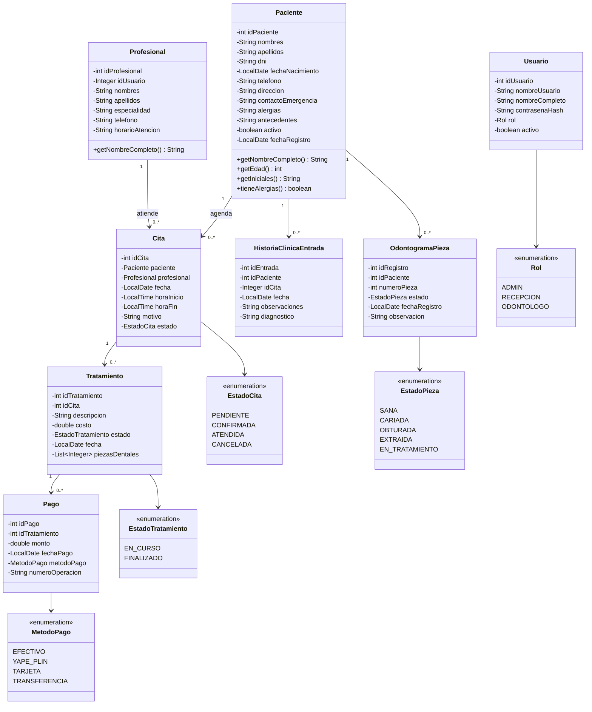

# Vyra — Diagrama de Clases

**Versión:** 0.2
**Fecha:** 2026-10-29

Este documento traduce el modelo de base de datos ([`03-modelo-base-datos.md`](./03-modelo-base-datos.md)) a clases Java, organizadas en capas (modelo, DAO, servicio, controlador) según RNF-06. Describe **cómo debe quedar** el código; la sección 5 lista lo que todavía falta respecto al código actual.

Todo vive bajo el paquete raíz `com.vyra.dental`.

## 1. Modelo (`com.vyra.dental.model`)

Clases con Lombok (`@Data @NoArgsConstructor @AllArgsConstructor`) y validaciones de Jakarta (`@NotBlank`, `@Pattern`...), como las que ya existen. No tienen lógica de negocio ni SQL.

**Decisiones del modelo:**
- `Cita` guarda objetos `Paciente` y `Profesional` completos porque la agenda siempre los muestra. Las demás entidades guardan solo el id del padre (`idPaciente`, `idCita`, `idTratamiento`), para no cargar más datos de los necesarios.
- Los enums tienen un método `getEtiqueta()` con el texto que ve el usuario (`EN_TRATAMIENTO` → "En tratamiento", `YAPE_PLIN` → "Yape / Plin"). La UI nunca muestra `name()` directamente.
- `EstadoPieza` además tiene `getCodigo()` (`""`, `"C"`, `"O"`, `"X"`, `"T"`) para el odontograma, y `EstadoCita`/`EstadoTratamiento` tienen `getClaseCss()` (`"pill-confirmada"`...). Ver [`08-guia-frontend.md`](./08-guia-frontend.md).
- `Usuario` **no** calcula hashes. Hoy existe `Usuario.autenticar()` con SHA-256 sin sal; eso se mueve a `util.HashUtil` y a `AuthService` (RN-13).
- Validaciones nuevas: `Cita` (`@NotNull` en paciente, profesional, fecha, horaInicio, horaFin y estado), `Profesional` (`@NotBlank` en nombres y apellidos, teléfono de 9 dígitos), `Usuario.nombreCompleto` (`@NotBlank`), `Pago.metodoPago` (`@NotNull`), `HistoriaClinicaEntrada.fecha` (`@NotNull`), `OdontogramaPieza` (`@NotNull` en estado) y número de pieza entre 11 y 48 en `OdontogramaPieza` y `Tratamiento.piezasDentales` (RN-10; el `CHECK` de la BD rechaza además 19, 20, 29...).
- `Usuario.contrasenaHash` ya no tiene `@Size(min = 4)`: valida un hash, no la contraseña. El largo mínimo de la contraseña lo revisará `UsuarioService`.

## 2. Acceso a datos (`com.vyra.dental.dao` y `dao.impl`)

Una interfaz por entidad en `dao/`. La implementación con SQLite va en `dao/impl/` con el sufijo `DAOSqlite` (ej. `PacienteDAOSqlite`). Las implementaciones en memoria que existen hoy (`PacienteDAOImpl`...) se mueven a `dao/memoria/` con el sufijo `DAOMemoria` y se usan en las pruebas unitarias de los servicios.

Se mantiene la convención de nombres del código actual: `crear`, `buscarPorId` (devuelve `Optional`), `listarTodos`, `actualizar` (devuelve `boolean`) y `eliminar`.

```mermaid
classDiagram
    class UsuarioDAO {
        <<interface>>
        +crear(Usuario) Usuario
        +buscarPorId(int) Optional~Usuario~
        +buscarPorNombreUsuario(String) Optional~Usuario~
        +listarTodos() List~Usuario~
        +contar() int
        +actualizar(Usuario) boolean
    }
    class ProfesionalDAO {
        <<interface>>
        +crear(Profesional) Profesional
        +buscarPorId(int) Optional~Profesional~
        +buscarPorIdUsuario(int) Optional~Profesional~
        +listarTodos() List~Profesional~
        +actualizar(Profesional) boolean
        +eliminar(int) boolean
    }
    class PacienteDAO {
        <<interface>>
        +crear(Paciente) Paciente
        +buscarPorId(int) Optional~Paciente~
        +buscarPorDni(String) Optional~Paciente~
        +buscar(String texto, int limite, int desde) List~Paciente~
        +contarActivos(String texto) int
        +actualizar(Paciente) boolean
        +darDeBaja(int) boolean
    }
    class CitaDAO {
        <<interface>>
        +crear(Cita) Cita
        +buscarPorId(int) Optional~Cita~
        +listarPorFecha(LocalDate) List~Cita~
        +listarPorProfesionalYFecha(int, LocalDate) List~Cita~
        +listarPorPaciente(int) List~Cita~
        +existeCruce(int idProf, LocalDate, LocalTime ini, LocalTime fin, int excluirId) boolean
        +actualizar(Cita) boolean
        +actualizarEstado(int, EstadoCita) boolean
    }
    class HistoriaClinicaDAO {
        <<interface>>
        +crear(HistoriaClinicaEntrada) HistoriaClinicaEntrada
        +listarPorPaciente(int) List~HistoriaClinicaEntrada~
    }
    class OdontogramaDAO {
        <<interface>>
        +registrar(OdontogramaPieza) OdontogramaPieza
        +estadoActual(int idPaciente) List~OdontogramaPieza~
        +historialPieza(int idPaciente, int numeroPieza) List~OdontogramaPieza~
    }
    class TratamientoDAO {
        <<interface>>
        +crear(Tratamiento) Tratamiento
        +buscarPorId(int) Optional~Tratamiento~
        +listarTodos() List~Tratamiento~
        +listarPorPaciente(int) List~Tratamiento~
        +listarPorEstado(EstadoTratamiento) List~Tratamiento~
        +actualizar(Tratamiento) boolean
        +eliminar(int) boolean
    }
    class PagoDAO {
        <<interface>>
        +crear(Pago) Pago
        +buscarPorId(int) Optional~Pago~
        +listarTodos() List~Pago~
        +listarPorTratamiento(int) List~Pago~
        +listarPorPeriodo(LocalDate, LocalDate) List~Pago~
        +totalPagado(int idTratamiento) double
        +actualizar(Pago) boolean
        +eliminar(int) boolean
    }
```

Reglas para los `DAOSqlite`:
- Piden la conexión a `ConexionBD.obtenerConexion()` y **no la cierran** (es compartida). Sí cierran sus `PreparedStatement` y `ResultSet` con try-with-resources.
- Siempre `PreparedStatement` con `?`. Nunca concatenar texto del usuario en el SQL.
- Convierten `SQLException` en `RuntimeException("No se pudo <acción>", e)`; el controlador muestra el mensaje.
- `TratamientoDAOSqlite.crear()` inserta el tratamiento y sus filas de `tratamiento_pieza` en una sola transacción (`setAutoCommit(false)` … `commit()`).
- Las consultas complejas (estado actual del odontograma, cruce de horario, saldo...) están escritas en la sección 5 de [`03-modelo-base-datos.md`](./03-modelo-base-datos.md).

## 3. Servicios (`com.vyra.dental.service`)

Aquí viven las reglas de negocio (RN-xx de [`01-requerimientos.md`](./01-requerimientos.md#6-reglas-de-negocio-rn)). Reciben los DAO por constructor, para poder probarlos con los `DAOMemoria`. No importan nada de JavaFX ni de `java.sql`.

```mermaid
classDiagram
    class AuthService {
        +iniciarSesion(String usuario, String contrasena) Usuario
        +cerrarSesion() void
        +cambiarContrasena(int idUsuario, String actual, String nueva) void
    }
    class Sesion {
        <<singleton>>
        +getUsuario() Usuario
        +getProfesional() Optional~Profesional~
        +tieneRol(Rol...) boolean
    }
    class PacienteService {
        +registrar(Paciente) Paciente
        +actualizar(Paciente) void
        +darDeBaja(int) void
        +buscar(String texto, int pagina) List~Paciente~
    }
    class CitaService {
        +agendar(Cita) Cita
        +reprogramar(Cita) void
        +cancelar(int) void
        +confirmar(int) void
        +marcarAtendida(int) void
        +existeCruceDeHorario(Cita) boolean
        +horariosLibres(int idProf, LocalDate, int duracionMin) List~LocalTime~
        +citasDelDia(LocalDate) List~Cita~
    }
    class HistoriaClinicaService {
        +registrarEntrada(HistoriaClinicaEntrada) void
        +historial(int idPaciente) List~HistoriaClinicaEntrada~
    }
    class OdontogramaService {
        +estadoActual(int idPaciente) Map~Integer,EstadoPieza~
        +registrarCambios(int idPaciente, Map~Integer,EstadoPieza~, String obs) void
        +historialPieza(int idPaciente, int pieza) List~OdontogramaPieza~
    }
    class TratamientoService {
        +registrar(Tratamiento) Tratamiento
        +finalizar(int) void
        +listarPorPaciente(int) List~Tratamiento~
    }
    class PagoService {
        +registrar(Pago) Pago
        +saldo(int idTratamiento) double
    }
    class ReporteService {
        +citasDelDia(LocalDate) List~Cita~
        +citasDeLaSemana(LocalDate) List~Cita~
        +historialPaciente(int) List~Tratamiento~
        +ingresosPorPeriodo(LocalDate, LocalDate) Map~MetodoPago,Double~
    }
    class ProfesionalService
    class UsuarioService

    CitaService --> CitaDAO
    PacienteService --> PacienteDAO
    AuthService --> UsuarioDAO
    AuthService --> Sesion
    OdontogramaService --> OdontogramaDAO
    PagoService --> PagoDAO
    PagoService --> TratamientoDAO
    ReporteService --> CitaDAO
    ReporteService --> PagoDAO
```

- Cuando una regla no se cumple, el servicio lanza `ReglaNegocioException` (en `service/`, hereda de `RuntimeException`) con un mensaje listo para mostrarse al usuario: "El Dr. Salinas ya tiene una cita de 09:00 a 10:00".
- `Validador.validar()` sigue lanzando `IllegalArgumentException` con los mensajes de Jakarta. Los controladores atrapan las dos excepciones y muestran el mensaje en el formulario.
- `Sesion` guarda el usuario que inició sesión. Si es odontólogo, también guarda su `Profesional` (vía `ProfesionalDAO.buscarPorIdUsuario`).
- `ProfesionalService` y `UsuarioService` son CRUD simples con validación. `UsuarioService.crear()` recibe la contraseña en texto plano y guarda `HashUtil.hashear(contrasena)`.

## 4. Controladores y utilidades

| Paquete | Clases |
|---|---|
| `controller` | `LoginController`, `MainController`, `InicioController`, `AgendaController`, `PacientesController`, `HistoriaClinicaController`, `OdontogramaController`, `TratamientosController`, `PagosController`, `ReportesController`, `ProfesionalesController`, `UsuariosController` |
| `ui` | Componentes JavaFX reutilizables: `Icono` (SVGPath), `Avatar` (iniciales), `Pill` (estado), `PiezaDental` (botón del odontograma), `Aviso` (alertas en línea), `Notificacion` (toast) |
| `util` | `ConexionBD` (existe), `Validador` (existe), `HashUtil` (PBKDF2), `DatosIniciales` (admin y datos de ejemplo), `Formatos` (fechas en español, soles) |

El detalle de cada pantalla y de cada componente está en [`08-guia-frontend.md`](./08-guia-frontend.md).

## 5. Diferencias con el código actual (a corregir)

Las filas del modelo (de `Usuario` a `Pago`) quedaron corregidas en la fase 1 del [plan](./09-plan-implementacion.md).

| Clase | Hoy | Debe quedar |
|---|---|---|
| `Usuario` | ✔ Corregido (fase 1) | Agregar campos; mover el hash a `HashUtil` (PBKDF2) |
| `Profesional` | ✔ Corregido (fase 1) | Agregar campos y validaciones |
| `Paciente` | ✔ Corregido (fase 1) | Agregar campos y métodos `getEdad()`, `getIniciales()`, `tieneAlergias()` |
| `Cita` | ✔ Corregido (fase 1) | Agregar `@NotNull` |
| `HistoriaClinicaEntrada` | ✔ Corregido (fase 1) | Agregar |
| `OdontogramaPieza` | ✔ Corregido (fase 1) | Agregar |
| `Tratamiento` | ✔ Corregido (fase 1) | Agregar |
| `Pago` | ✔ Corregido (fase 1) | Agregar campos; `metodoPago` pasa a enum `MetodoPago` |
| DAO | Solo Usuario, Paciente, Tratamiento y Pago, en memoria (`dao/memoria/*DAOMemoria`) | Las 8 interfaces de la sección 2, con implementación SQLite |
| Servicios | No existen | Los de la sección 3 |
| `demo/*CrudDemoApp` | CRUD de prueba con `Alert` | Se mantienen hasta tener las pantallas reales; luego se borran |

---

*Siguiente documento: [`05-arquitectura.md`](./05-arquitectura.md) — cómo se conectan estas capas entre sí.*
