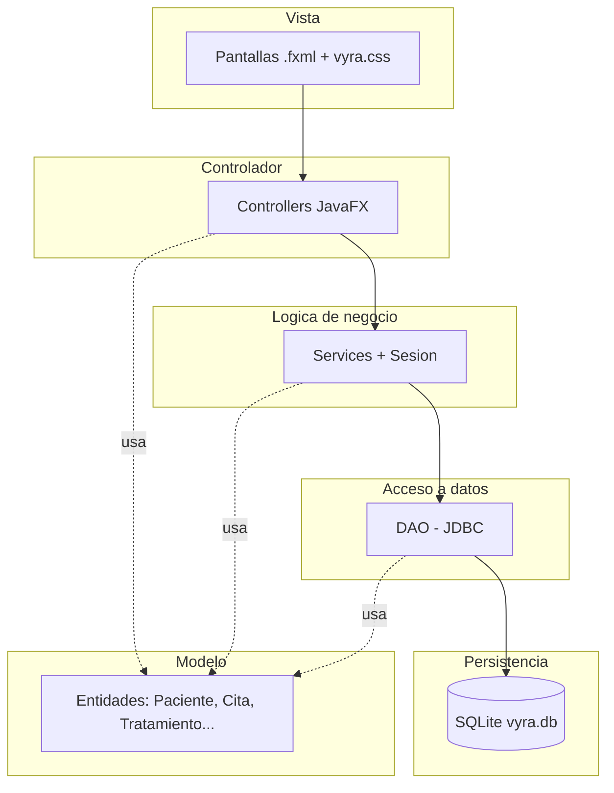
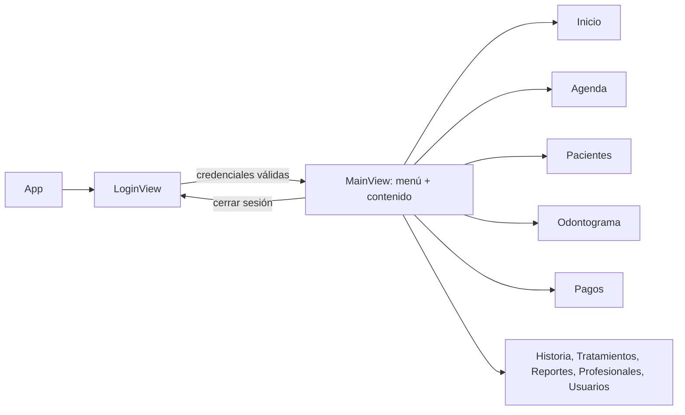

# Vyra — Arquitectura del Sistema

**Versión:** 0.2
**Fecha:** 2026-10-29

## 1. Estilo de arquitectura

Vyra usa una arquitectura en capas, combinada con el patrón MVC que JavaFX impone de forma natural a través de FXML. Cada capa depende solo de la inmediatamente inferior, nunca al revés: esto es lo que pide RNF-06 y lo que permite que 4 personas trabajen en paralelo.



## 2. Responsabilidad de cada capa

**Vista (FXML + CSS):** define solo la apariencia: botones, tablas, formularios. No contiene lógica. Los colores y tamaños salen de `vyra.css`, nunca de `style="..."` en el FXML (salvo casos puntuales).

**Controlador:** recibe los eventos de la vista (un clic en "Guardar"), arma el objeto del modelo con los datos del formulario, llama a un Service y muestra el resultado o el error. Un controlador por pantalla (ej. `PacientesController`). **No** llama a los DAO directamente.

**Servicio (lógica de negocio):** las reglas que no son solo "guardar": `CitaService.existeCruceDeHorario()` (CU-03), `PagoService.saldo()` (CU-10), `ReporteService.ingresosPorPeriodo()` (CU-09). No sabe nada de JavaFX ni de SQL; solo usa los DAO.

**DAO (Data Access Object):** una interfaz por entidad y su implementación SQLite. Solo ejecuta consultas. Si un día se migra a MySQL (RNF-02), solo se reescriben los DAO.

**Modelo:** POJOs con Lombok y anotaciones de validación. Sin lógica de negocio ni de base de datos.

## 3. Estructura de paquetes

```
src/main/java/
├── module-info.java
└── com/vyra/dental/
    ├── App.java                 punto de entrada: abre LoginView
    ├── model/                   Paciente, Cita, Profesional, Tratamiento, Pago, enums...
    ├── dao/                     interfaces: PacienteDAO, CitaDAO...
    │   ├── impl/                implementaciones SQLite: PacienteDAOSqlite...
    │   └── memoria/             implementaciones en memoria (para pruebas)
    ├── service/                 CitaService, PagoService, AuthService, Sesion, Servicios, ReglaNegocioException...
    ├── controller/              un controller por pantalla FXML
    ├── ui/                      componentes reutilizables: Icono, Avatar, Pill, PiezaDental...
    ├── util/                    ConexionBD, Validador, HashUtil, DatosIniciales, Formatos
    └── demo/                    CRUDs de prueba (temporales, se borran al terminar la UI)

src/main/resources/com/vyra/
├── schema.sql                   script de tablas (ver 03-modelo-base-datos.md)
├── views/                       archivos .fxml (LoginView.fxml, MainView.fxml, PacientesView.fxml...)
├── styles/vyra.css              hoja de estilos única
└── fonts/                       Inter-Regular.ttf, Inter-Medium.ttf, Inter-SemiBold.ttf, Inter-Bold.ttf

src/test/java/com/vyra/dental/   pruebas JUnit 5 de los servicios
```

`module-info.java` debe abrir a JavaFX los paquetes que se cargan por reflexión:

```java
opens com.vyra.dental.controller to javafx.fxml;
opens com.vyra.dental.ui to javafx.fxml;
exports com.vyra.dental.controller;
exports com.vyra.dental.service;
exports com.vyra.dental.ui;
```

Java no permite `exports`/`opens` de un paquete sin clases; por eso estas líneas se fueron activando en `module-info.java` a medida que cada paquete tuvo su primera clase (fases 1 y 2 del [plan](./09-plan-implementacion.md)). `module-info` también requiere `java.prefs` ("Recordar mi usuario" del login).

**Cómo obtiene un controlador sus servicios:** con `service.Servicios` (por ejemplo `Servicios.auth()`), que crea cada servicio una sola vez con sus DAO SQLite. Así los controladores nunca crean ni llaman DAO, y las pruebas crean los servicios directamente con los `DAOMemoria`.

## 4. Navegación entre pantallas



- `App.start()` muestra `LoginView.fxml` en una ventana de 1100×680.
- Al iniciar sesión, la misma ventana cambia su escena a `MainView.fxml` y se maximiza (mínimo 1280×800).
- `MainView` es un `BorderPane`: a la izquierda el menú lateral (`VBox`), arriba la barra superior y en el centro un `StackPane` llamado `contenido`.
- `MainController.navegar(Pantalla destino)` carga el FXML con `FXMLLoader` y reemplaza los hijos de `contenido`. `Pantalla` es un enum con el nombre del FXML, el título, el ícono y los roles permitidos (la matriz de [`02-casos-de-uso.md`](./02-casos-de-uso.md#3-matriz-de-permisos-por-rol)). El menú se construye recorriendo ese enum y mostrando solo lo que el rol permite.
- Para abrir una pantalla con un dato, por ejemplo el odontograma de un paciente, `MainController` expone `navegar(Pantalla, Object parametro)`, y el controlador destino implementa una interfaz `RecibeParametro` con `void recibir(Object parametro)`.

## 5. Sesión y permisos

- `AuthService.iniciarSesion()` valida las credenciales y llena `Sesion` (singleton en `service/`).
- Cualquier controlador puede consultar `Sesion.get().getUsuario()` para mostrar el nombre o filtrar datos (el odontólogo solo ve sus citas en Inicio).
- Los servicios que escriben datos sensibles verifican el rol (`Sesion.get().tieneRol(Rol.ODONTOLOGO)`) aunque el menú ya lo oculte. Si no tiene permiso: `ReglaNegocioException("No tienes permiso para esta acción")`.

## 6. Cómo se conecta a la base de datos

La única clase `util.ConexionBD` abre la conexión JDBC a SQLite (`jdbc:sqlite:vyra.db`, en la carpeta desde donde se ejecuta la app) y la reutiliza en toda la aplicación. Al abrirla:

1. Ejecuta `PRAGMA foreign_keys = ON;` (SQLite no verifica las claves foráneas si no se activa).
2. Ejecuta `schema.sql` (crea las tablas si no existen).
3. `App` llama luego a `DatosIniciales.crearAdminSiNoExiste(new UsuarioDAOSqlite())`.

La URL se puede cambiar con la propiedad `-Dvyra.bd.url`. Las pruebas (`mvn test`) usan `jdbc:sqlite::memory:` (configurado en el `maven-surefire-plugin` del `pom.xml`), así nunca tocan el `vyra.db` de desarrollo.

Los DAO nunca abren su propia conexión: así se evitan bloqueos del archivo `.db`.

## 7. Errores, validación y tareas largas

- **Validación en 3 niveles:** el controlador revisa campos vacíos y formato (para dar respuesta inmediata), el modelo tiene anotaciones Jakarta que `Validador` revisa, y el servicio verifica las reglas de negocio (duplicados, cruces, saldo).
- **Mostrar errores:** junto al campo que falló (borde rojo + texto debajo, con `ui.CampoFormulario`) o en un `Aviso` dentro del formulario. El controlador sabe qué campo falló por `ValidacionException.getErrores()` (Jakarta) y `ReglaNegocioException.getCampo()` (servicio). No usar `Alert` emergentes para errores de validación; solo para confirmar acciones destructivas ("¿Dar de baja a este paciente?").
- **Éxito:** una notificación breve (toast) en la esquina inferior derecha, que desaparece sola a los 3 segundos.
- **Hilos:** las operaciones con SQLite son rápidas (RNF-04: menos de 2 s) y pueden ir en el hilo de JavaFX. Solo la exportación a PDF y los reportes de periodos largos se ejecutan en un `javafx.concurrent.Task` para no congelar la ventana.

## 8. Cómo se ejecuta

| Acción | Comando |
|---|---|
| Ejecutar la app | `mvn javafx:run` |
| Compilar | `mvn compile` |
| Ejecutar pruebas | `mvn test` |
| Ver el diseño de referencia | Abrir `docs/ui/Inicio.html` en el navegador |

Versión de Java: **21** (JDK 21 + JavaFX 21); el `pom.xml` compila con `release 21`.

## 9. División de trabajo sugerida para el equipo

Equipo: Daniel, Evelyn, Smith y Johan. Con esta arquitectura, el trabajo se reparte por módulo sin que nadie pise el código de otro (cada quien trabaja en sus propias clases y archivos):

| Módulo | Responsabilidad | Responsable |
|---|---|---|
| Base e integración | Fases 0 a 2 del plan: `util/`, `ConexionBD`, `schema.sql`, `MainView` + menú, `vyra.css`, login y sesión | _(por asignar)_ |
| Pacientes y agenda | `model`, `dao`, `service`, `controller` y `view` de pacientes y citas | _(por asignar)_ |
| Clínica | Historia clínica, odontograma y exportación a PDF | _(por asignar)_ |
| Administración | Tratamientos, pagos, reportes, profesionales y usuarios | _(por asignar)_ |

Al asignar los módulos, completar también la tabla de la sección 1.1 del documento de requerimientos.

---

*Siguientes documentos: [`08-guia-frontend.md`](./08-guia-frontend.md) (pantallas y estilos) y [`09-plan-implementacion.md`](./09-plan-implementacion.md) (orden de trabajo).*
