# Vyra — Manual de Usuario

**Versión:** 1.0
**Fecha:** 2026-11-10

Las capturas de este manual son de la aplicación real con los datos de ejemplo (pacientes y profesionales ficticios). Están en [`docs/manual/`](./manual).

## 1. Introducción

Vyra es una aplicación de escritorio para el trabajo diario de un consultorio dental. Reúne en un solo lugar a los pacientes, la agenda de los odontólogos, la historia clínica, el odontograma, los tratamientos y los pagos.

La usan tres tipos de personas, cada una con su propio usuario y su rol:

| Rol | Qué hace en Vyra |
|---|---|
| **Recepción** | Registra pacientes, agenda y confirma citas, y cobra los tratamientos. |
| **Odontólogo/a** | Ve sus citas, escribe la historia clínica, marca el odontograma y registra los tratamientos. |
| **Administrador** | Ve todo, consulta los reportes y gestiona los profesionales y los usuarios. |

El menú de la izquierda solo muestra las pantallas que tu rol puede usar (ver la tabla de la sección 12).

## 2. Instalación y primer ingreso

**Requisitos:** Windows 10 u 11 de 64 bits. No hace falta instalar Java: la versión instalada lo trae incluido.

1. Copia la carpeta `Vyra` (o ejecuta el instalador `.msi`, si te lo entregaron) en la computadora del consultorio.
2. Abre `Vyra.exe`.
3. Ingresa con el usuario **`admin`** y la contraseña **`admin123`**.
4. Entra a **Usuarios y roles**, crea un usuario para cada persona del consultorio y, en tu propio usuario, usa **Restablecer contraseña** para cambiar `admin123` por una contraseña propia.

Los datos se guardan en un archivo en `%LOCALAPPDATA%\Vyra\vyra.db` (por ejemplo, `C:\Users\Recepcion\AppData\Local\Vyra\vyra.db`). **Para hacer una copia de seguridad, cierra Vyra y copia ese archivo** a un USB o a la nube.

## 3. Inicio de sesión (CU-08)

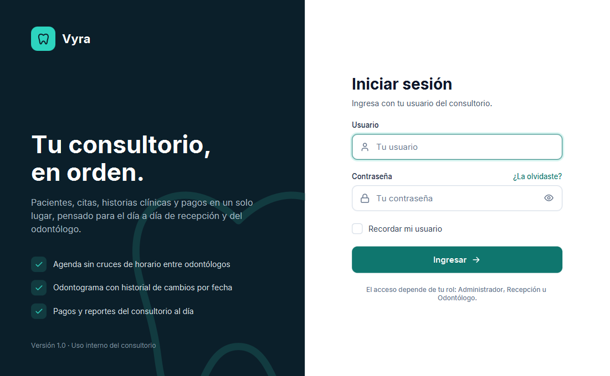

1. Escribe tu **usuario** y tu **contraseña**. El ojo de la derecha muestra u oculta la contraseña.
2. Marca **Recordar mi usuario** si siempre usas la misma computadora.
3. Pulsa **Ingresar** (o Enter).

Si el usuario o la contraseña no son correctos, aparece "Usuario o contraseña incorrectos" (por seguridad no se dice cuál de los dos). Si tu usuario fue desactivado, no podrás entrar: pide al administrador que lo active.

## 4. Inicio

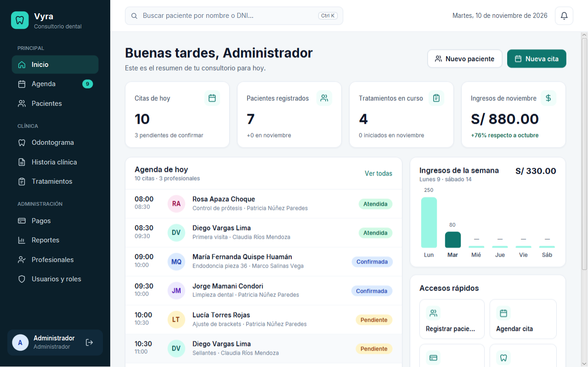

Es la primera pantalla después de ingresar:

- **Aviso de citas próximas:** si hay citas en la próxima hora, aparece una franja verde con los nombres y la hora (RF-12). "Ver agenda" abre la Agenda.
- **Indicadores:** citas de hoy, pacientes registrados, tratamientos en curso y, según tu rol, los ingresos del mes (administrador), los pagos de hoy (recepción) o tus citas atendidas (odontólogo).
- **Agenda de hoy:** haz clic en una cita para abrirla en la Agenda.
- **Accesos rápidos** y, arriba, el **buscador de pacientes**: escribe un nombre o un DNI y elige al paciente para abrir su ficha. Desde cualquier pantalla, **Ctrl+K** te trae a este buscador.

## 5. Pacientes (CU-01)

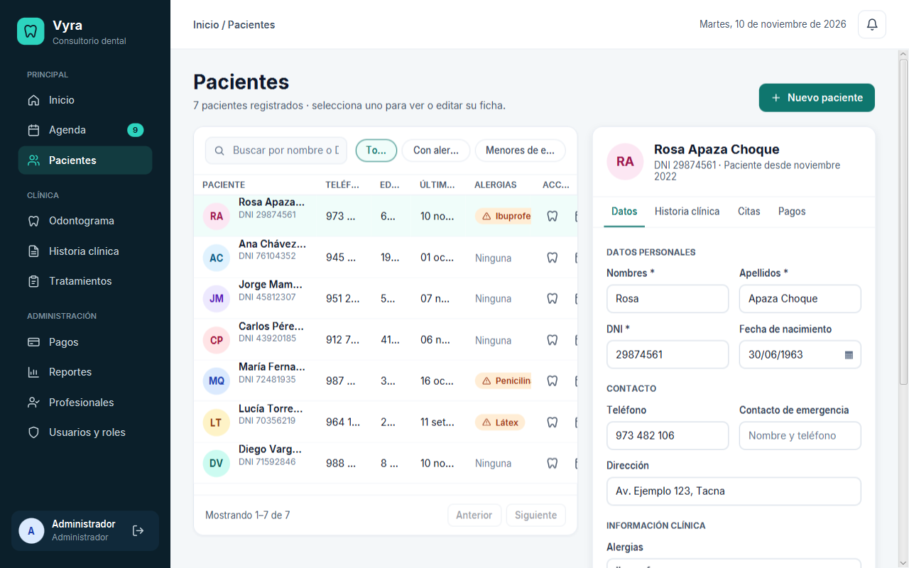

**Registrar un paciente nuevo:**

1. Pulsa **Nuevo paciente**.
2. Completa los datos. Los campos con `*` son obligatorios: nombres, apellidos y DNI (8 dígitos).
3. Si tiene alergias, escríbelas en **Alergias**: se mostrarán como alerta en su odontograma.
4. Pulsa **Registrar paciente**.

Si algo está mal, el error aparece en rojo debajo del campo (por ejemplo, "El DNI debe tener 8 dígitos" o "Ya existe un paciente con el DNI 72481935").

**Buscar y editar:** escribe en el buscador (nombre o DNI, con o sin tildes) y usa los filtros *Con alergias* y *Menores de edad*. Al elegir un paciente se abre su ficha a la derecha; cambia lo necesario y pulsa **Guardar cambios**.

**Dar de baja:** en la ficha, **Dar de baja** (pide confirmación). El paciente deja de aparecer en las búsquedas, pero su historial se conserva.

La ficha tiene pestañas: **Datos**, **Historia clínica** (administrador y odontólogo), **Citas** y **Pagos** (administrador y recepción).

## 6. Agenda (CU-02, CU-03)

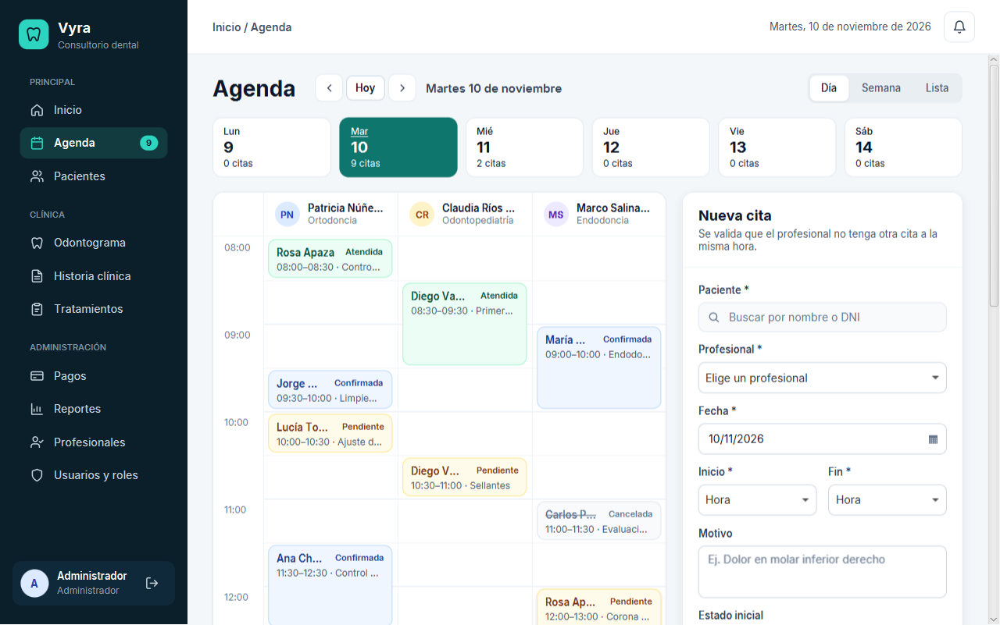

La agenda muestra una columna por profesional. Arriba eliges el día con las flechas, **Hoy** o la tira de la semana, y la vista: **Día**, **Semana** o **Lista**.

**Agendar una cita:**

1. Haz clic en un espacio libre de la cuadrícula (o completa el panel **Nueva cita**).
2. Elige el **paciente** (búscalo por nombre o DNI), el **profesional**, la **fecha** y la **hora de inicio**. La hora de fin se propone sola (30 minutos después) y se puede cambiar.
3. Escribe el motivo y elige si queda **Pendiente** o **Confirmada**.
4. Pulsa **Agendar cita**.

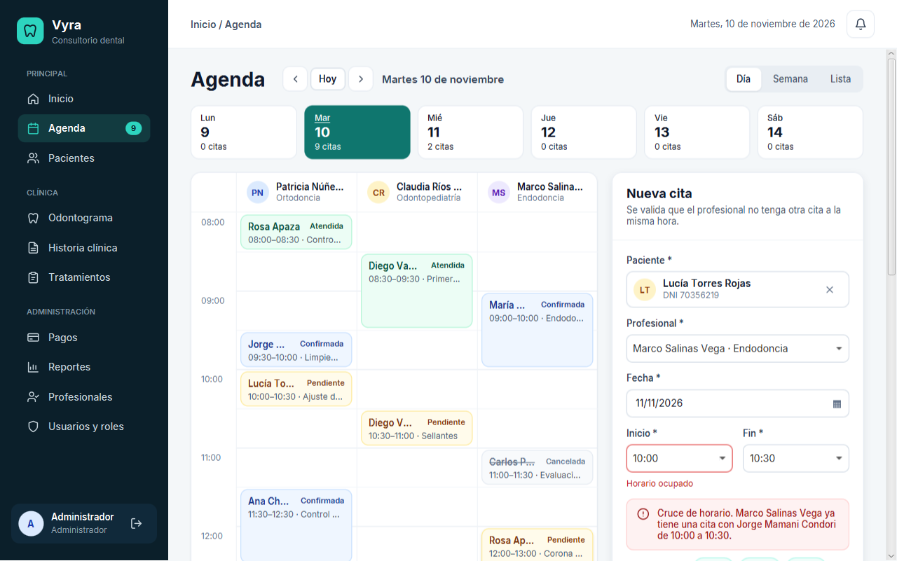

**Cruce de horario:** si el profesional ya tiene una cita a esa hora, Vyra lo avisa antes de guardar y propone **horarios libres**; haz clic en uno para usarlo. Las citas van en bloques de 30 minutos, de 08:00 a 20:00, y no se pueden agendar en fechas u horas que ya pasaron.

**Estados de una cita:**

| Estado | Significado |
|---|---|
| Pendiente | Agendada, falta confirmar con el paciente. |
| Confirmada | El paciente confirmó que vendrá. |
| Atendida | El odontólogo la atendió (lo marca el odontólogo o recepción). |
| Cancelada | No se realizará. No se borra: queda en el historial y libera el horario. |

Al elegir una cita se ven sus datos y los botones para **confirmar**, **reprogramar**, **cancelar** o **marcar como atendida**.

## 7. Historia clínica (CU-04)

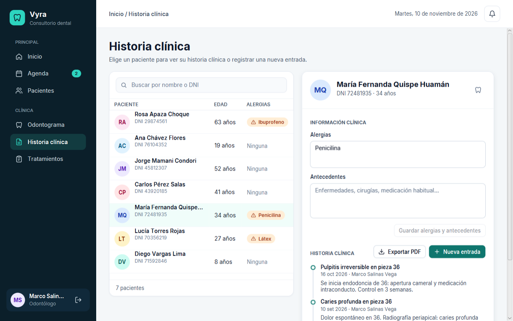

Se abre desde el menú (eliges al paciente en el buscador) o desde la pestaña **Historia clínica** de su ficha.

- **Alergias y antecedentes:** el odontólogo los actualiza aquí y pulsa **Guardar alergias y antecedentes**.
- **Nueva entrada:** escribe el diagnóstico y/o las observaciones de la visita. La fecha es la de hoy y la cita de hoy del paciente se elige sola. Pulsa **Guardar entrada**.
- Las entradas **no se pueden editar ni borrar** después de guardarlas: se agrega una nueva si hace falta corregir algo.
- **Exportar PDF** guarda la historia clínica completa para imprimirla (CU-11).

## 8. Odontograma (CU-05)

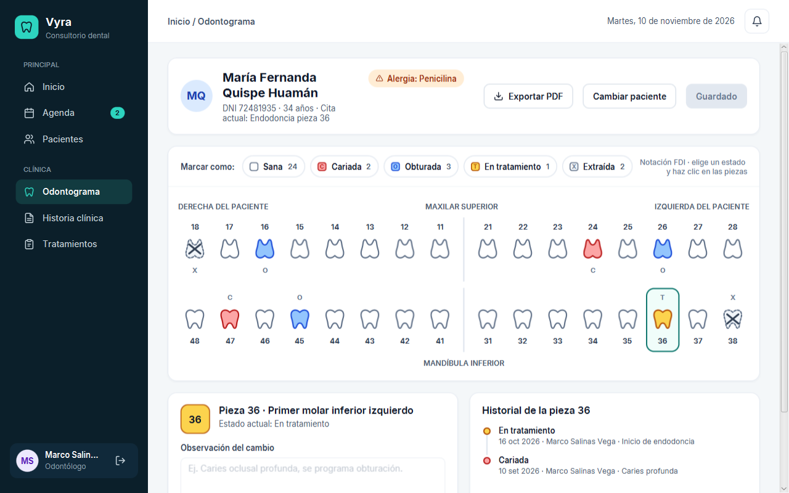

Muestra las 32 piezas en notación FDI. Cada estado tiene un color y una letra: **C** cariada, **O** obturada, **T** en tratamiento, **X** extraída (sin letra = sana).

**Registrar cambios:**

1. En **Marcar como**, elige el estado (por ejemplo, *Cariada*).
2. Haz clic en las piezas que quieres marcar. Las piezas cambiadas quedan con borde punteado: todavía no están guardadas.
3. Elige una pieza para escribir la **observación del cambio** y ver su **historial**.
4. Pulsa **Guardar n cambios**.

Si sales de la pantalla con cambios sin guardar, Vyra pregunta antes de descartarlos. El historial de cada pieza conserva todos sus cambios con la fecha y el profesional.

Desde una pieza, **Registrar tratamiento para esta pieza** abre Tratamientos con la pieza ya escrita. **Exportar PDF** genera el odontograma impreso.

## 9. Tratamientos y pagos (CU-06, CU-10)

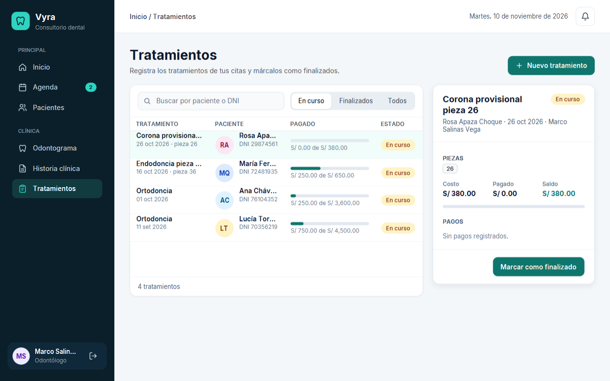

**Registrar un tratamiento (odontólogo):**

1. Pulsa **Nuevo tratamiento**.
2. Elige la **cita** (de hoy o atendida en los últimos 30 días), escribe la **descripción**, las **piezas** separadas por comas (por ejemplo `36, 47`) y el **costo**.
3. Pulsa **Registrar tratamiento**. Cuando termine, usa **Marcar como finalizado**.

La barra de cada tratamiento muestra cuánto se pagó de su costo.

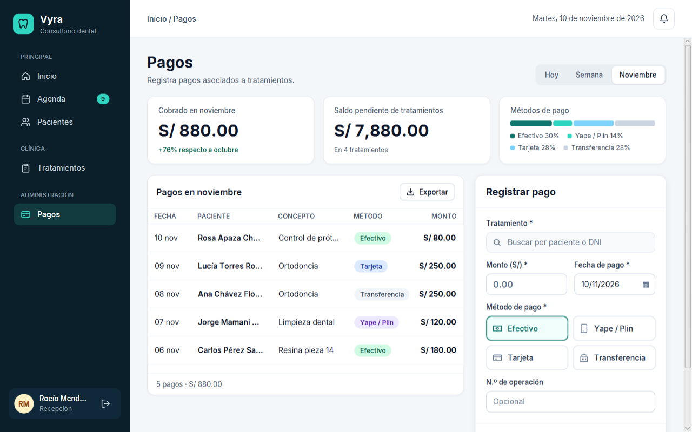

**Registrar un pago (recepción o administrador):**

1. En **Pagos**, busca el tratamiento por el nombre o DNI del paciente (o pulsa **Registrar pago** desde Tratamientos, o **Cobrar** en la pestaña Pagos de la ficha).
2. Escribe el **monto**, revisa la **fecha** (no puede ser futura) y elige el **método**: efectivo, Yape/Plin, tarjeta o transferencia. El número de operación es opcional.
3. Abajo verás el saldo que quedará. Pulsa **Registrar pago**.

No se puede cobrar más que el saldo pendiente: "El monto supera el saldo pendiente (S/ 400.00)". Arriba, los indicadores muestran lo cobrado en el periodo (hoy, semana o mes), el saldo pendiente y el reparto por método. **Exportar** guarda los pagos del periodo en PDF.

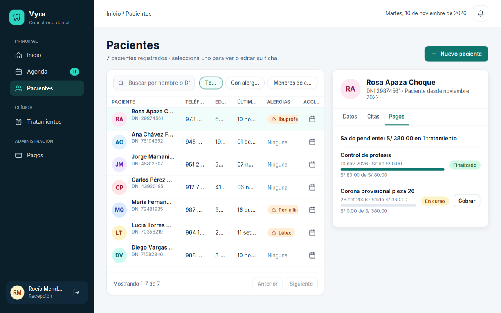

## 10. Reportes (CU-09) — solo Administrador

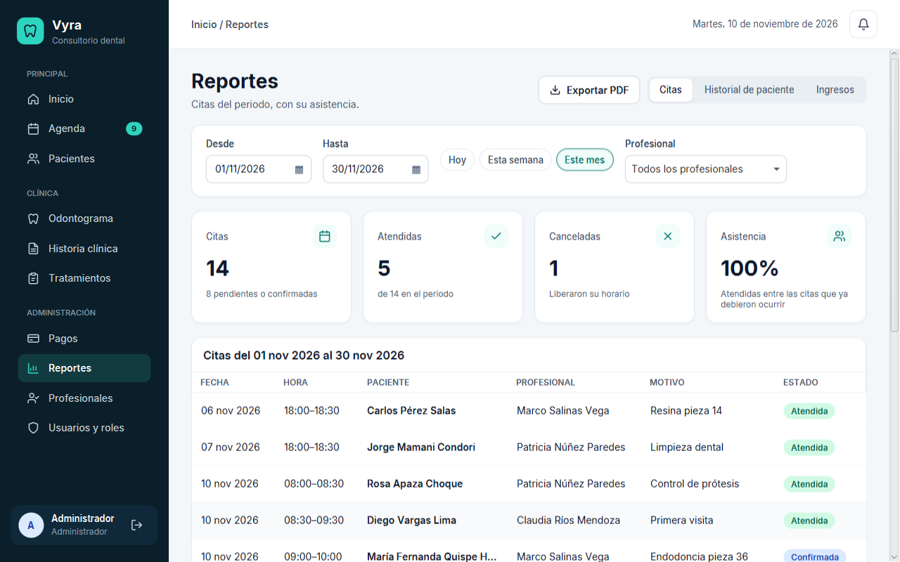

Elige el tipo de reporte arriba a la derecha:

- **Citas:** citas del periodo (y de un profesional, si quieres), con atendidas, canceladas y el % de asistencia.
- **Historial de paciente:** busca al paciente y verás sus tratamientos con el costo, lo pagado y el saldo.
- **Ingresos:** lo cobrado por método de pago y por día.

Cambia las fechas o usa **Hoy**, **Esta semana** o **Este mes**; el reporte se actualiza solo. **Exportar PDF** guarda el reporte que estás viendo.

## 11. Profesionales y usuarios — solo Administrador

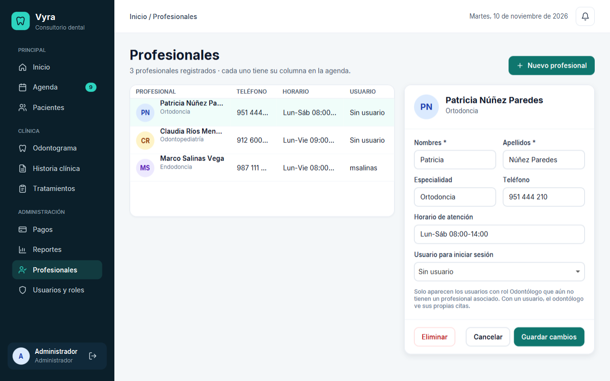

**Profesionales (CU-07):** registra a cada odontólogo con su especialidad, teléfono y horario. Cada uno tiene su columna en la agenda. Para que un odontólogo vea sus citas al ingresar, asócialo a su **usuario** (con rol Odontólogo) en el campo *Usuario para iniciar sesión*. Un profesional con citas no se puede eliminar.

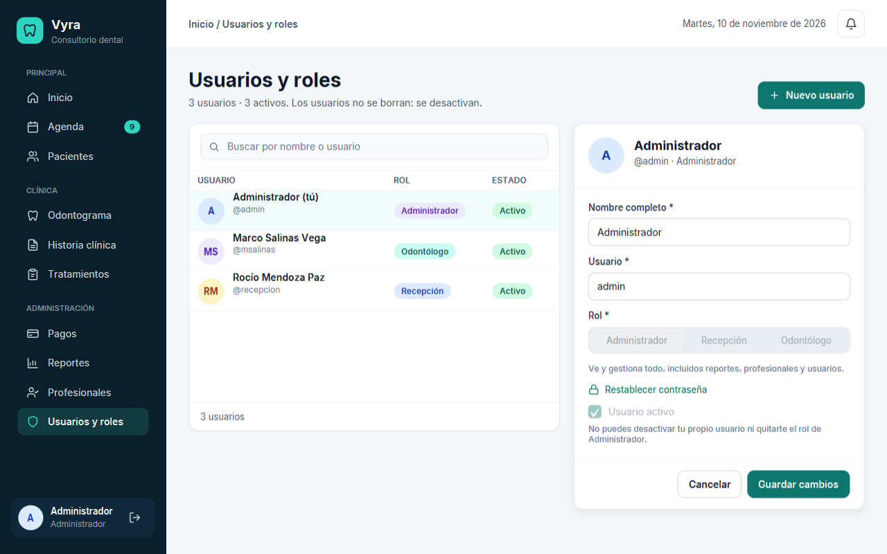

**Usuarios y roles (RF-08):** crea un usuario por persona, con su nombre completo, el usuario para ingresar (sin espacios), el rol y una contraseña de al menos 6 caracteres. Para que alguien deje de entrar, desmarca **Usuario activo**: los usuarios no se borran. Si alguien olvidó su contraseña, usa **Restablecer contraseña**. No puedes desactivarte ni quitarte el rol de administrador a ti mismo.

## 12. Qué ve cada rol

| Pantalla | Administrador | Recepción | Odontólogo/a |
|---|---|---|---|
| Inicio | Sí | Sí | Sí (sus citas) |
| Agenda | Sí | Sí | Sus citas + marcar "Atendida" |
| Pacientes | Sí | Sí | Solo lectura |
| Historia clínica | Solo lectura | No | Sí |
| Odontograma | Solo lectura | No | Sí |
| Tratamientos | Solo lectura | Solo lectura (para cobrar) | Sí |
| Pagos | Sí | Sí | No |
| Reportes, Profesionales, Usuarios | Sí | No | No |

## 13. Preguntas frecuentes

**Olvidé mi contraseña.** Pide al administrador que use *Restablecer contraseña* en Usuarios y roles. Si el administrador olvidó la suya y no hay otro administrador, hay que recuperar una copia de seguridad de `vyra.db`.

**Soy odontólogo y no veo ninguna cita.** Tu usuario no está asociado a un profesional. El administrador debe hacerlo en **Profesionales**, campo *Usuario para iniciar sesión*.

**No me deja agendar a esa hora.** El profesional ya tiene otra cita que se cruza, la hora ya pasó o está fuera del horario (08:00 a 20:00 en bloques de 30 minutos). Usa uno de los horarios libres que propone el formulario.

**No aparece un paciente que registré antes.** Revisa que el filtro sea *Todos* y que el texto del buscador esté vacío. Si se dio de baja, ya no aparece en las búsquedas (su historial se conserva).

**Marqué piezas en el odontograma y no se guardaron.** Los cambios quedan pendientes (borde punteado) hasta pulsar **Guardar n cambios**.

**El PDF no se guarda.** Si ya existe un archivo con ese nombre y está abierto en el visor de PDF, ciérralo y vuelve a exportar.

**¿Cómo hago una copia de seguridad?** Cierra Vyra y copia `%LOCALAPPDATA%\Vyra\vyra.db` (escribe esa ruta en la barra del Explorador de archivos). Para restaurarla, cierra Vyra y vuelve a poner el archivo en esa carpeta.

---

*Este manual, con sus capturas, es también el anexo de la memoria descriptiva ([`07-memoria-descriptiva.md`](./07-memoria-descriptiva.md)).*
